# Hi! 😃 I'm William

<picture>
  <source media="(prefers-color-scheme: dark)" srcset="https://readme-typing-svg.demolab.com/?font=Fira+Code&weight=500&size=22&duration=2800&pause=1400&color=E6E6E6&background=00000000&center=false&vCenter=true&width=640&lines=AI+%26+Data+Platform+Engineer;AI+Agents%2C+Data+Pipelines%2C+Business+Intelligence;Turning+business+requirements+into+reliable+production+systems;Order+from+chaos" />
  <source media="(prefers-color-scheme: light)" srcset="https://readme-typing-svg.demolab.com/?font=Fira+Code&weight=500&size=22&duration=2800&pause=1400&color=1A1A1A&background=00000000&center=false&vCenter=true&width=640&lines=AI+%26+Data+Platform+Engineer;AI+Agents%2C+Data+Pipelines%2C+Business+Intelligence;Turning+business+requirements+into+reliable+production+systems;Order+from+chaos" />
  
</picture>

 

I am a technology professional with over four years of experience designing, building, and supporting production data and AI platforms, the kind that quietly do their job every day. I work across three connected pillars

- AI platform engineering — agent orchestration, retrieval-augmented generation, LLM gateway integration, and cloud deployment.
- Data platform and Business Intelligence engineering — ETL pipeline development, analytical data modelling, dashboard delivery, and data quality.
- Full-stack web solution delivery — platforms that turn agent and data work into interfaces people actually use.

I translate business and programme requirements into systems that are grounded, observable, and reliable in production, and I support them after release through documentation, second-line support, and structured training.

I care about three things

- Getting the facts right.
- Keeping systems running.
- Making sure people feel confident using what I build.

If something is slowing your team down, I'd love to hear about it.

*Simplex sigillum veri. Simplicity is the mark of truth* 🧭

### What I work with

**Languages**
 

**Frameworks & libraries**
 

**Data engineering & lakehouse**
 

![Amazon S3](https://img.shields.io/badge/Amazon%20S3-1C3C3C?style=flat-square&logo=data:image/svg+xml;base64,PHN2ZyB4bWxucz0iaHR0cDovL3d3dy53My5vcmcvMjAwMC9zdmciIHZpZXdCb3g9IjAgMCAyNTYgMjU2IiBmaWxsPSJub25lIj48cGF0aCBmaWxsPSIjRjkwIiBmaWxsLXJ1bGU9ImV2ZW5vZGQiIGQ9Ik0yMDcuODM3IDE2Mi44MTZDMTg2LjE5MiAxNzguODAzIDE1NC43NDUgMTg3LjI5IDEyNy43MDUgMTg3LjI5Qzg5LjgxMDUgMTg3LjI5IDU1LjY2NTggMTczLjI3NiAyOS44NzYzIDE0OS45ODdDMjcuODM2OSAxNDguMTQ1IDI5LjY3OSAxNDUuNjQ1IDMyLjExMzIgMTQ3LjA5MkM2MC4wMDc5IDE2My4yNzYgOTQuNDE1OCAxNzMuMDc5IDEzMC4wMDggMTczLjA3OUMxNTQuMDIxIDE3My4wNzkgMTgwLjQwMyAxNjguMDc5IDIwNC42NzkgMTU3LjgxNkMyMDguMjk3IDE1Ni4xNzEgMjExLjM4OSAxNjAuMTg0IDIwNy44MzcgMTYyLjgxNloiIGNsaXAtcnVsZT0iZXZlbm9kZCIvPjxwYXRoIGZpbGw9IiNGOTAiIGZpbGwtcnVsZT0iZXZlbm9kZCIgZD0iTTIxNi44NSAxNTIuNTUzQzIxNC4wODcgMTQ5IDE5OC41NjEgMTUwLjg0MiAxOTEuNTIxIDE1MS42OTdDMTg5LjQxNiAxNTEuOTYxIDE4OS4wODcgMTUwLjExOCAxOTAuOTk1IDE0OC43MzdDMjAzLjM2MyAxNDAuMDUzIDIyMy42OTIgMTQyLjU1MyAyMjYuMDYxIDE0NS40NDdDMjI4LjQyOSAxNDguNDA4IDIyNS40MDMgMTY4LjczNyAyMTMuODI0IDE3OC40NzRDMjEyLjA0NyAxNzkuOTg3IDIxMC4zMzcgMTc5LjE5NyAyMTEuMTI2IDE3Ny4yMjRDMjEzLjc1OCAxNzAuNzExIDIxOS42MTMgMTU2LjAzOSAyMTYuODUgMTUyLjU1M1oiIGNsaXAtcnVsZT0iZXZlbm9kZCIvPjwvc3ZnPg==&logoColor=white)

**Databases & caching**
 

 

**Cloud & DevOps**
 

 
![Amazon EC2](https://img.shields.io/badge/Amazon%20EC2-1C3C3C?style=flat-square&logo=data:image/svg+xml;base64,PHN2ZyB4bWxucz0iaHR0cDovL3d3dy53My5vcmcvMjAwMC9zdmciIHZpZXdCb3g9IjAgMCAyNTYgMjU2IiBmaWxsPSJub25lIj48cGF0aCBmaWxsPSIjRjkwIiBmaWxsLXJ1bGU9ImV2ZW5vZGQiIGQ9Ik0yMDcuODM3IDE2Mi44MTZDMTg2LjE5MiAxNzguODAzIDE1NC43NDUgMTg3LjI5IDEyNy43MDUgMTg3LjI5Qzg5LjgxMDUgMTg3LjI5IDU1LjY2NTggMTczLjI3NiAyOS44NzYzIDE0OS45ODdDMjcuODM2OSAxNDguMTQ1IDI5LjY3OSAxNDUuNjQ1IDMyLjExMzIgMTQ3LjA5MkM2MC4wMDc5IDE2My4yNzYgOTQuNDE1OCAxNzMuMDc5IDEzMC4wMDggMTczLjA3OUMxNTQuMDIxIDE3My4wNzkgMTgwLjQwMyAxNjguMDc5IDIwNC42NzkgMTU3LjgxNkMyMDguMjk3IDE1Ni4xNzEgMjExLjM4OSAxNjAuMTg0IDIwNy44MzcgMTYyLjgxNloiIGNsaXAtcnVsZT0iZXZlbm9kZCIvPjxwYXRoIGZpbGw9IiNGOTAiIGZpbGwtcnVsZT0iZXZlbm9kZCIgZD0iTTIxNi44NSAxNTIuNTUzQzIxNC4wODcgMTQ5IDE5OC41NjEgMTUwLjg0MiAxOTEuNTIxIDE1MS42OTdDMTg5LjQxNiAxNTEuOTYxIDE4OS4wODcgMTUwLjExOCAxOTAuOTk1IDE0OC43MzdDMjAzLjM2MyAxNDAuMDUzIDIyMy42OTIgMTQyLjU1MyAyMjYuMDYxIDE0NS40NDdDMjI4LjQyOSAxNDguNDA4IDIyNS40MDMgMTY4LjczNyAyMTMuODI0IDE3OC40NzRDMjEyLjA0NyAxNzkuOTg3IDIxMC4zMzcgMTc5LjE5NyAyMTEuMTI2IDE3Ny4yMjRDMjEzLjc1OCAxNzAuNzExIDIxOS42MTMgMTU2LjAzOSAyMTYuODUgMTUyLjU1M1oiIGNsaXAtcnVsZT0iZXZlbm9kZCIvPjwvc3ZnPg==&logoColor=white)
![Amazon ECS](https://img.shields.io/badge/Amazon%20ECS-1C3C3C?style=flat-square&logo=data:image/svg+xml;base64,PHN2ZyB4bWxucz0iaHR0cDovL3d3dy53My5vcmcvMjAwMC9zdmciIHZpZXdCb3g9IjAgMCAyNTYgMjU2IiBmaWxsPSJub25lIj48cGF0aCBmaWxsPSIjRjkwIiBmaWxsLXJ1bGU9ImV2ZW5vZGQiIGQ9Ik0yMDcuODM3IDE2Mi44MTZDMTg2LjE5MiAxNzguODAzIDE1NC43NDUgMTg3LjI5IDEyNy43MDUgMTg3LjI5Qzg5LjgxMDUgMTg3LjI5IDU1LjY2NTggMTczLjI3NiAyOS44NzYzIDE0OS45ODdDMjcuODM2OSAxNDguMTQ1IDI5LjY3OSAxNDUuNjQ1IDMyLjExMzIgMTQ3LjA5MkM2MC4wMDc5IDE2My4yNzYgOTQuNDE1OCAxNzMuMDc5IDEzMC4wMDggMTczLjA3OUMxNTQuMDIxIDE3My4wNzkgMTgwLjQwMyAxNjguMDc5IDIwNC42NzkgMTU3LjgxNkMyMDguMjk3IDE1Ni4xNzEgMjExLjM4OSAxNjAuMTg0IDIwNy44MzcgMTYyLjgxNloiIGNsaXAtcnVsZT0iZXZlbm9kZCIvPjxwYXRoIGZpbGw9IiNGOTAiIGZpbGwtcnVsZT0iZXZlbm9kZCIgZD0iTTIxNi44NSAxNTIuNTUzQzIxNC4wODcgMTQ5IDE5OC41NjEgMTUwLjg0MiAxOTEuNTIxIDE1MS42OTdDMTg5LjQxNiAxNTEuOTYxIDE4OS4wODcgMTUwLjExOCAxOTAuOTk1IDE0OC43MzdDMjAzLjM2MyAxNDAuMDUzIDIyMy42OTIgMTQyLjU1MyAyMjYuMDYxIDE0NS40NDdDMjI4LjQyOSAxNDguNDA4IDIyNS40MDMgMTY4LjczNyAyMTMuODI0IDE3OC40NzRDMjEyLjA0NyAxNzkuOTg3IDIxMC4zMzcgMTc5LjE5NyAyMTEuMTI2IDE3Ny4yMjRDMjEzLjc1OCAxNzAuNzExIDIxOS42MTMgMTU2LjAzOSAyMTYuODUgMTUyLjU1M1oiIGNsaXAtcnVsZT0iZXZlbm9kZCIvPjwvc3ZnPg==&logoColor=white)
![Amazon RDS](https://img.shields.io/badge/Amazon%20RDS-1C3C3C?style=flat-square&logo=data:image/svg+xml;base64,PHN2ZyB4bWxucz0iaHR0cDovL3d3dy53My5vcmcvMjAwMC9zdmciIHZpZXdCb3g9IjAgMCAyNTYgMjU2IiBmaWxsPSJub25lIj48cGF0aCBmaWxsPSIjRjkwIiBmaWxsLXJ1bGU9ImV2ZW5vZGQiIGQ9Ik0yMDcuODM3IDE2Mi44MTZDMTg2LjE5MiAxNzguODAzIDE1NC43NDUgMTg3LjI5IDEyNy43MDUgMTg3LjI5Qzg5LjgxMDUgMTg3LjI5IDU1LjY2NTggMTczLjI3NiAyOS44NzYzIDE0OS45ODdDMjcuODM2OSAxNDguMTQ1IDI5LjY3OSAxNDUuNjQ1IDMyLjExMzIgMTQ3LjA5MkM2MC4wMDc5IDE2My4yNzYgOTQuNDE1OCAxNzMuMDc5IDEzMC4wMDggMTczLjA3OUMxNTQuMDIxIDE3My4wNzkgMTgwLjQwMyAxNjguMDc5IDIwNC42NzkgMTU3LjgxNkMyMDguMjk3IDE1Ni4xNzEgMjExLjM4OSAxNjAuMTg0IDIwNy44MzcgMTYyLjgxNloiIGNsaXAtcnVsZT0iZXZlbm9kZCIvPjxwYXRoIGZpbGw9IiNGOTAiIGZpbGwtcnVsZT0iZXZlbm9kZCIgZD0iTTIxNi44NSAxNTIuNTUzQzIxNC4wODcgMTQ5IDE5OC41NjEgMTUwLjg0MiAxOTEuNTIxIDE1MS42OTdDMTg5LjQxNiAxNTEuOTYxIDE4OS4wODcgMTUwLjExOCAxOTAuOTk1IDE0OC43MzdDMjAzLjM2MyAxNDAuMDUzIDIyMy42OTIgMTQyLjU1MyAyMjYuMDYxIDE0NS40NDdDMjI4LjQyOSAxNDguNDA4IDIyNS40MDMgMTY4LjczNyAyMTMuODI0IDE3OC40NzRDMjEyLjA0NyAxNzkuOTg3IDIxMC4zMzcgMTc5LjE5NyAyMTEuMTI2IDE3Ny4yMjRDMjEzLjc1OCAxNzAuNzExIDIxOS42MTMgMTU2LjAzOSAyMTYuODUgMTUyLjU1M1oiIGNsaXAtcnVsZT0iZXZlbm9kZCIvPjwvc3ZnPg==&logoColor=white)
![Amazon ECR](https://img.shields.io/badge/Amazon%20ECR-1C3C3C?style=flat-square&logo=data:image/svg+xml;base64,PHN2ZyB4bWxucz0iaHR0cDovL3d3dy53My5vcmcvMjAwMC9zdmciIHZpZXdCb3g9IjAgMCAyNTYgMjU2IiBmaWxsPSJub25lIj48cGF0aCBmaWxsPSIjRjkwIiBmaWxsLXJ1bGU9ImV2ZW5vZGQiIGQ9Ik0yMDcuODM3IDE2Mi44MTZDMTg2LjE5MiAxNzguODAzIDE1NC43NDUgMTg3LjI5IDEyNy43MDUgMTg3LjI5Qzg5LjgxMDUgMTg3LjI5IDU1LjY2NTggMTczLjI3NiAyOS44NzYzIDE0OS45ODdDMjcuODM2OSAxNDguMTQ1IDI5LjY3OSAxNDUuNjQ1IDMyLjExMzIgMTQ3LjA5MkM2MC4wMDc5IDE2My4yNzYgOTQuNDE1OCAxNzMuMDc5IDEzMC4wMDggMTczLjA3OUMxNTQuMDIxIDE3My4wNzkgMTgwLjQwMyAxNjguMDc5IDIwNC42NzkgMTU3LjgxNkMyMDguMjk3IDE1Ni4xNzEgMjExLjM4OSAxNjAuMTg0IDIwNy44MzcgMTYyLjgxNloiIGNsaXAtcnVsZT0iZXZlbm9kZCIvPjxwYXRoIGZpbGw9IiNGOTAiIGZpbGwtcnVsZT0iZXZlbm9kZCIgZD0iTTIxNi44NSAxNTIuNTUzQzIxNC4wODcgMTQ5IDE5OC41NjEgMTUwLjg0MiAxOTEuNTIxIDE1MS42OTdDMTg5LjQxNiAxNTEuOTYxIDE4OS4wODcgMTUwLjExOCAxOTAuOTk1IDE0OC43MzdDMjAzLjM2MyAxNDAuMDUzIDIyMy42OTIgMTQyLjU1MyAyMjYuMDYxIDE0NS40NDdDMjI4LjQyOSAxNDguNDA4IDIyNS40MDMgMTY4LjczNyAyMTMuODI0IDE3OC40NzRDMjEyLjA0NyAxNzkuOTg3IDIxMC4zMzcgMTc5LjE5NyAyMTEuMTI2IDE3Ny4yMjRDMjEzLjc1OCAxNzAuNzExIDIxOS42MTMgMTU2LjAzOSAyMTYuODUgMTUyLjU1M1oiIGNsaXAtcnVsZT0iZXZlbm9kZCIvPjwvc3ZnPg==&logoColor=white)
![AWS IAM](https://img.shields.io/badge/AWS%20IAM-1C3C3C?style=flat-square&logo=data:image/svg+xml;base64,PHN2ZyB4bWxucz0iaHR0cDovL3d3dy53My5vcmcvMjAwMC9zdmciIHZpZXdCb3g9IjAgMCAyNTYgMjU2IiBmaWxsPSJub25lIj48cGF0aCBmaWxsPSIjRjkwIiBmaWxsLXJ1bGU9ImV2ZW5vZGQiIGQ9Ik0yMDcuODM3IDE2Mi44MTZDMTg2LjE5MiAxNzguODAzIDE1NC43NDUgMTg3LjI5IDEyNy43MDUgMTg3LjI5Qzg5LjgxMDUgMTg3LjI5IDU1LjY2NTggMTczLjI3NiAyOS44NzYzIDE0OS45ODdDMjcuODM2OSAxNDguMTQ1IDI5LjY3OSAxNDUuNjQ1IDMyLjExMzIgMTQ3LjA5MkM2MC4wMDc5IDE2My4yNzYgOTQuNDE1OCAxNzMuMDc5IDEzMC4wMDggMTczLjA3OUMxNTQuMDIxIDE3My4wNzkgMTgwLjQwMyAxNjguMDc5IDIwNC42NzkgMTU3LjgxNkMyMDguMjk3IDE1Ni4xNzEgMjExLjM4OSAxNjAuMTg0IDIwNy44MzcgMTYyLjgxNloiIGNsaXAtcnVsZT0iZXZlbm9kZCIvPjxwYXRoIGZpbGw9IiNGOTAiIGZpbGwtcnVsZT0iZXZlbm9kZCIgZD0iTTIxNi44NSAxNTIuNTUzQzIxNC4wODcgMTQ5IDE5OC41NjEgMTUwLjg0MiAxOTEuNTIxIDE1MS42OTdDMTg5LjQxNiAxNTEuOTYxIDE4OS4wODcgMTUwLjExOCAxOTAuOTk1IDE0OC43MzdDMjAzLjM2MyAxNDAuMDUzIDIyMy42OTIgMTQyLjU1MyAyMjYuMDYxIDE0NS40NDdDMjI4LjQyOSAxNDguNDA4IDIyNS40MDMgMTY4LjczNyAyMTMuODI0IDE3OC40NzRDMjEyLjA0NyAxNzkuOTg3IDIxMC4zMzcgMTc5LjE5NyAyMTEuMTI2IDE3Ny4yMjRDMjEzLjc1OCAxNzAuNzExIDIxOS42MTMgMTU2LjAzOSAyMTYuODUgMTUyLjU1M1oiIGNsaXAtcnVsZT0iZXZlbm9kZCIvPjwvc3ZnPg==&logoColor=white)
![AWS Systems Manager](https://img.shields.io/badge/AWS%20Systems%20Manager-1C3C3C?style=flat-square&logo=data:image/svg+xml;base64,PHN2ZyB4bWxucz0iaHR0cDovL3d3dy53My5vcmcvMjAwMC9zdmciIHZpZXdCb3g9IjAgMCAyNTYgMjU2IiBmaWxsPSJub25lIj48cGF0aCBmaWxsPSIjRjkwIiBmaWxsLXJ1bGU9ImV2ZW5vZGQiIGQ9Ik0yMDcuODM3IDE2Mi44MTZDMTg2LjE5MiAxNzguODAzIDE1NC43NDUgMTg3LjI5IDEyNy43MDUgMTg3LjI5Qzg5LjgxMDUgMTg3LjI5IDU1LjY2NTggMTczLjI3NiAyOS44NzYzIDE0OS45ODdDMjcuODM2OSAxNDguMTQ1IDI5LjY3OSAxNDUuNjQ1IDMyLjExMzIgMTQ3LjA5MkM2MC4wMDc5IDE2My4yNzYgOTQuNDE1OCAxNzMuMDc5IDEzMC4wMDggMTczLjA3OUMxNTQuMDIxIDE3My4wNzkgMTgwLjQwMyAxNjguMDc5IDIwNC42NzkgMTU3LjgxNkMyMDguMjk3IDE1Ni4xNzEgMjExLjM4OSAxNjAuMTg0IDIwNy44MzcgMTYyLjgxNloiIGNsaXAtcnVsZT0iZXZlbm9kZCIvPjxwYXRoIGZpbGw9IiNGOTAiIGZpbGwtcnVsZT0iZXZlbm9kZCIgZD0iTTIxNi44NSAxNTIuNTUzQzIxNC4wODcgMTQ5IDE5OC41NjEgMTUwLjg0MiAxOTEuNTIxIDE1MS42OTdDMTg5LjQxNiAxNTEuOTYxIDE4OS4wODcgMTUwLjExOCAxOTAuOTk1IDE0OC43MzdDMjAzLjM2MyAxNDAuMDUzIDIyMy42OTIgMTQyLjU1MyAyMjYuMDYxIDE0NS40NDdDMjI4LjQyOSAxNDguNDA4IDIyNS40MDMgMTY4LjczNyAyMTMuODI0IDE3OC40NzRDMjEyLjA0NyAxNzkuOTg3IDIxMC4zMzcgMTc5LjE5NyAyMTEuMTI2IDE3Ny4yMjRDMjEzLjc1OCAxNzAuNzExIDIxOS42MTMgMTU2LjAzOSAyMTYuODUgMTUyLjU1M1oiIGNsaXAtcnVsZT0iZXZlbm9kZCIvPjwvc3ZnPg==&logoColor=white)

**AI & LLM engineering**
 

### What I'm working on right now

- **A LangGraph multi-agent academic advisory platform** — supervisor-routed agents, PostgreSQL-checkpointed state, and a PGVector RAG layer with deterministic SQL guardrails so a model never invents a result.
- **TOIL Calculator, a production HR platform for a leading international education agency** — automates Time Off In Lieu calculation, tracking, and expiry across a multi-country workforce, with OCR-assisted international travel claims and fine-grained, role-based access. Built with Laravel, Inertia, and React.
- **KwanAluora, a sustainability data platform** — turns raw facility activity data into deterministic, auditable carbon-accounting figures in a governed analytical warehouse. Built on a Kafka-fed Spark/Iceberg lakehouse orchestrated by Airflow, containerized and deployed to AWS (EC2, S3, ECR, IAM, Systems Manager) via Terraform and GitHub Actions.

### GitHub stats

<picture>
  <source media="(prefers-color-scheme: dark)" srcset="./profile/stats-dark.svg" />
  
</picture>
<picture>
  <source media="(prefers-color-scheme: dark)" srcset="./profile/top-langs-dark.svg" />
  
</picture>
<picture>
  <source media="(prefers-color-scheme: dark)" srcset="https://streak-stats.demolab.com/?user=williamnyangor&theme=github-dark-blue&hide_border=true&background=00000000" />
  
</picture>

### Get in touch

